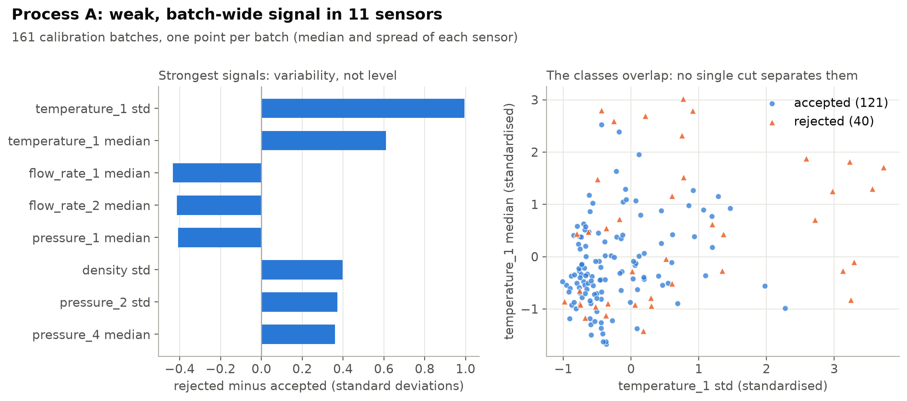
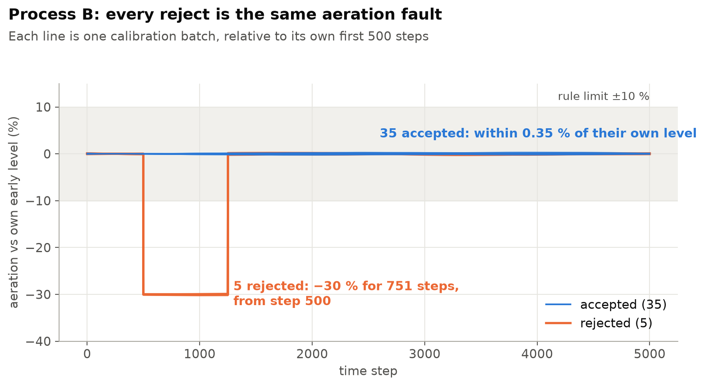
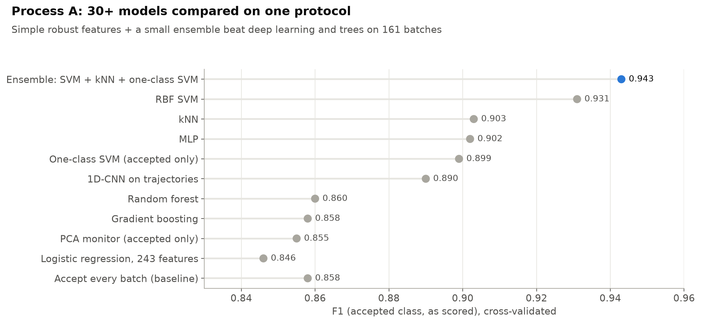
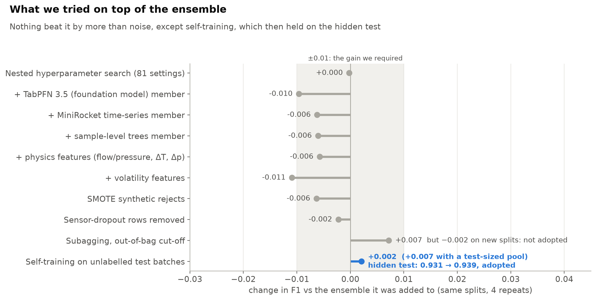
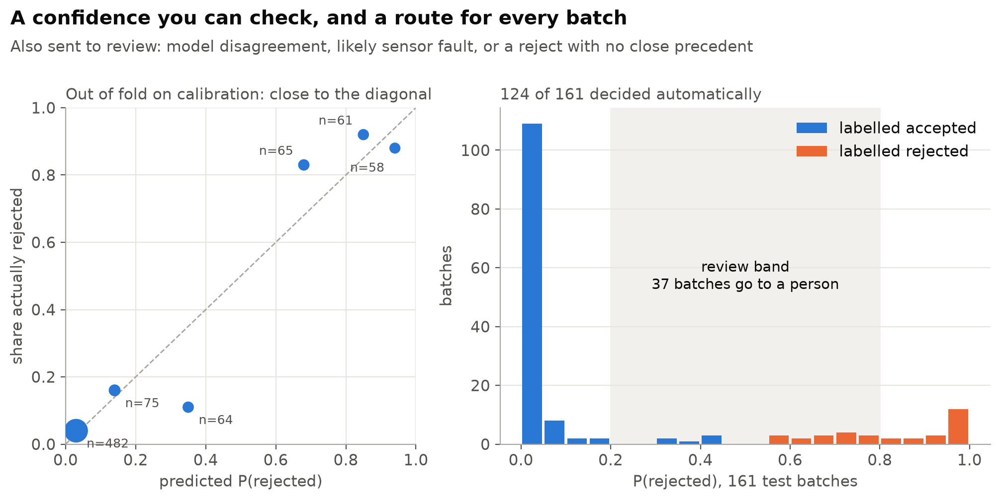

# Building Resilient Process Monitoring Models — Team 08

STEM4Health × Johnson & Johnson hackathon, Project 2. Decide for each production batch whether it is
**accepted** or **rejected**, from its sensor time series, for two processes:

- **A:** an industrial process (11 sensors);
- **B:** a simulated penicillin fermentation (IndPenSim).

| Leaderboard | Process A | Process B | Score |
|---|---|---|---|
| Team 08 | F1 0.939 (30 of 41 rejects caught, 4 false alarms) | F1 1.000 | 0.970 |

We used **two submissions**. Cross-validation predicted both results before we submitted
([below](#how-we-reached-0939-with-two-submissions)).

## The problem

- **Unit of decision: the batch.** Labels are per batch, but the data has one row per time step.
- **What is scored.** The score is the mean of the per-process F1. The brief says F1 of the
  rejected class, but every leaderboard entry's accuracy, precision and recall solve to 120 batches
  in the scored class. That is the accepted class (120 accepted, 41 rejected in A's test set).
  So a missed reject and a false alarm cost about the same, and accepting every batch already scores
  0.854. `brpmm.metrics.leaderboard_f1` computes it this way; tests/test_metric_alignment.py checks it.
- **A second, unscored solution.** Train on accepted batches only, as a plant would when rejects are rare.

## What the data tells us



**Process A.** 161 labelled batches: 121 accepted, 40 rejected; 196 to 2,932 steps long.
- **The signal is weak and spread over the whole batch.** The strongest difference is how much
  temperature_1 varies. The gap is the same in every tenth of the batch, so there is no fault window
  to look for.
- **The classes overlap.** 72 % of rejects have mostly accepted neighbours, so a perfect score is
  not available from these sensors.
- **Other patterns:**
  - shorter batches (under 2,700 steps) are rejected 40 % of the time, against 16 % for longer ones;
  - there are two operating modes, both present across the whole campaign;
  - a few batches have sensor dropouts, which inflate a PCA monitor's limits about 1,000×
    (A_239) unless those rows are masked.
- **The test set looks like the calibration set.** A classifier trying to tell them apart scores
  AUC 0.52–0.55, close to chance.
- **A labelling question.** The brief calls A_101–A_104 "rejected, borderline", but A_101 and A_103
  are labelled accepted. We took this to the organisers.



**Process B.** 40 labelled batches: 35 accepted, 5 rejected; 5,001 steps each.
- **All 5 rejects show the same fault:** aeration drops 30 % below the batch's own level for 751
  steps from step 500. Accepted batches stay within 0.35 % of their own level.
- **Four starting conditions** (volume, aeration, substrate, biomass) explain almost all the
  differences between batches.
- **Three test batches started outside the calibrated range:** B_026, B_029 and B_036 (volume).

**A trap we avoided.** Splitting rows at random lets a model memorise batches: it gave a fake
ROC-AUC of 1.00. Every split here is by batch, stratified and repeated.

## What we built

| | Process A | Process B |
|---|---|---|
| **Features** | median and spread of each sensor over the batch (22 numbers) | aeration relative to the batch's own first 500 steps |
| **Decision** | ensemble of RBF SVM, kNN (on PCA) and one-class SVM; scores standardised and averaged; cut-off chosen by nested CV to maximise the scored F1 | **rule:** aeration more than 10 % off its own level for ≥ 100 steps |
| **Unlabelled test batches** | **self-training:** confidently accepted test batches join the training set, then refit (allowed by the organisers) | not needed |
| **Beyond the label** | calibrated P(rejected), model agreement, 5 most similar past batches, drivers, sensor-fault and new-pattern notes, review route | reason with the onset step; **monitor trained on accepted batches only** flags batches unlike any seen before |
| **Accepted-only solution** | PCA (T², SPE) + kNN-distance monitor: catches 46 % of rejects at 94 % specificity (ROC-AUC 0.84), names the sensor | the same monitor: F1 1.000 |

## Approaches compared



**Model families** (5 repeats × 5-fold CV, F1 as scored; full list in [docs/model_results.md](docs/model_results.md)):

| Approach | F1 | What it taught us |
|---|---|---|
| Accept every batch | 0.858 | the bar to beat |
| Logistic regression, random forest, gradient boosting (243 features) | 0.846–0.860 | with 243 features and 40 rejects they barely beat accepting everything |
| PCA monitor, accepted only (243 features) | 0.855 | the same with 243 features for a one-class model |
| 1D-CNN on raw trajectories; MLP | 0.890; 0.902 | below a plain RBF SVM on 22 features: 161 batches are few for deep learning |
| One-class SVM, accepted only (22 features) | 0.899 | close to supervised, with no rejects needed |
| kNN; RBF SVM (22 features) | 0.903; 0.931 | few robust features work best |
| **Ensemble: SVM + kNN + one-class SVM** | **0.943** (0.930 nested; **0.941** on new splits) | **chosen:** each member errs on different batches |



**State-of-the-art and other ideas tried on top of the ensemble.** Each is scored on the same new
splits (s = 50–53, 4 repeats). The column shows the change against the exact ensemble it was added to.

| Idea | Change | Why it did not help (or did) |
|---|---|---|
| Nested hyperparameter search (81 settings; earlier on the one-class SVM: grid, random, Bayesian, genetic, particle swarm) | 0.000 | the best settings changed from fold to fold; the defaults already sit on the plateau |
| **TabPFN 3.5** (pretrained tabular foundation model, GPU) | −0.010 as a member; 0.909 alone | with 40 rejects it has no edge over an SVM, and it adds noise to the average |
| **MiniRocket** (time-series SOTA) | −0.006; −0.003 on the most volatile sensors only | the reject signal is spread over the whole batch, not a temporal pattern |
| Trained on samples, not batches (trees, batch decided by the 75th percentile) | −0.006 | samples from one batch are not independent; the label belongs to the batch |
| Physics features (flow/pressure, pressure drops, ΔT, mass flow); volatility features | −0.006; −0.011 | more columns dilute the SVM/kNN distances and add no new information |
| SMOTE synthetic rejects | −0.006 | the classes overlap, so interpolated "rejects" land among accepted batches |
| Sensor-dropout rows removed | −0.002 | fixes the one known false alarm but moves others |
| Subagging with out-of-bag cut-off | +0.007, then −0.002 on new splits | did not hold up: noise |
| Calibrated cut-off (Platt, F1-optimal rule) | +0.001 | already optimal; the decisions don't change |
| **Self-training on unlabelled test batches** | +0.002; +0.007 with a test-sized pool | **adopted:** on the hidden test, F1 0.931 → 0.939 |
| Self-training + subagging | +0.002 to +0.008 | rejected by a label-free check: it flagged 26 test batches where ~40 rejects are expected |

## What is new in our approach

1. **Self-training on the unlabelled test batches.** Simulated on calibration data first, submitted
   once, then confirmed on the hidden test: two false alarms removed, no reject lost.
2. **Every decision comes with a confidence you can check and a route** (`make report`).
   - **P(rejected) is calibrated out of fold.** Predicted 0.03 / 0.14 / 0.68 / 0.94 vs observed
     0.04 / 0.16 / 0.83 / 0.88.
   - **124 of 161 A batches are decided automatically; 37 go to a person.** A batch goes to review
     when:
     - P(rejected) is between 0.2 and 0.8;
     - the models disagree (out of fold this group was 22 % of batches but held 45 % of the errors);
     - a sensor fault is likely; or
     - a reject has no close precedent.
   - **Both batches later confirmed as false alarms (A_148, A_286) were in that review queue.**
3. **A sensor fault is not a process fault.** A_216 is rejected, but it has 52 sensor-dropout rows
   and none of the 5 most similar past batches was rejected, so the instrument should be checked first.
4. **Process B beyond 100 %.** Every team scores 1.000 on B. We add:
   - a rule an engineer can verify, with the onset step;
   - a monitor trained on accepted batches only, for faults never seen;
   - review flags for batches started outside the calibrated range.
5. **Label-free sanity checks before any submission.** One is the expected number of rejects
   (calibration share × test size). It stopped a variant that looked better in simulation.
6. **We worked out what the metric scores** (accepted-class F1) from the leaderboard figures, and
   tuned every cut-off for it.



**Example rows from `outputs/<time>_batch_report.csv`:**

| Batch | Label | P(rejected) | Models | Similar past batches rejected | Note / reason |
|---|---|---|---|---|---|
| A_001 | rejected | 0.97 | all 3 agree | 4 of 5 | temperature_1 spread; accepted-only monitor also flags temperature_1 |
| A_154 | rejected | 0.91 | disagree → review | 5 of 5 | pressure_2 level |
| A_216 | rejected | 0.85 | disagree → review | 0 of 5 | possible sensor fault (52 dropout rows); new pattern |
| A_148 | accepted | 0.37 | disagree → review | 3 of 5 | confirmed false alarm in our first submission |
| B_008 | rejected | high | rule | — | aeration 30 % off its own level for 751 steps from step 500 |
| B_026 | accepted | high | review | — | started outside calibrated volume; own aeration steady (max 0.15 %) |

## How we reached 0.939 with two submissions

- **Models are close, so we chose by repeated CV, not by single splits or the leaderboard.** For
  example, the chosen ensemble scores 0.941 on new splits and a rank average of the same three members
  0.935. That gap is about one batch, while one 161-batch test draw moves F1 by ±0.02.
- **Submission 1 (the ensemble).** CV predicted 30.8 rejects caught and 5.2 false alarms; the hidden
  test gave 30 and 6: **F1 0.931**.
- **Submission 2 (+ self-training).** Simulation predicted fewer false alarms (4.8); the hidden test
  gave 30 and 4: **F1 0.939**.
- **We stopped there on purpose.** With calibrated P(rejected), flipping a batch only pays above
  about 0.53. Our lowest flagged batch is at 0.59 and our highest unflagged batch at 0.44, so any
  further change lowers the expected F1.
- **Not done:** no probing of the leaderboard for labels. The test batches were used only without
  labels, through self-training, as the organisers allowed.

## Reproduce

```bash
make setup-local     # editable install + git hooks (on Renku: make setup)
make data            # stage the challenge data into data/raw (never committed)
make check           # ruff + 67 tests
python scripts/predict_self_training.py --only self_training_accepted_m1.0   # final leaderboard file
make report          # per-batch label, P(rejected), reasons, review route
make monitor         # accepted-only solution, A and B
make figures         # the figures above, into docs/figures/
make predict         # first submission (ensemble without self-training)
make tune tune-semi  # the experiments behind "Approaches compared" (~75 min)
```

Nothing is submitted automatically.

## Layout

```
src/brpmm/
  data.py, features.py        load batches; per-batch features
  methods.py, evaluate.py     every model as fit/score/explain; the shared CV protocol
  metrics.py, predict.py      scored F1 (accepted positive); final models -> submission file
  self_training.py            self-training on unlabelled batches
  process_b.py, rules.py      process B: aeration rule + accepted-only monitor
  mspc.py, novelty.py         accepted-only monitors: PCA (T², SPE, contributions), kNN distance
  preprocessing.py            segmentation, sensor-dropout mask, data-quality report
  evaluation.py               nested cut-offs, bootstrap, subagging, permutation importance
scripts/                      predict_self_training, batch_report, monitor, figures, tuning and EDA
docs/model_results.md         every model tried, its validation and score
docs/figures/                 figures in this README
tests/                        pytest on synthetic data
```

Data, outputs and the challenge documents are gitignored. Renku session instructions: [docs/renku.md](docs/renku.md).
